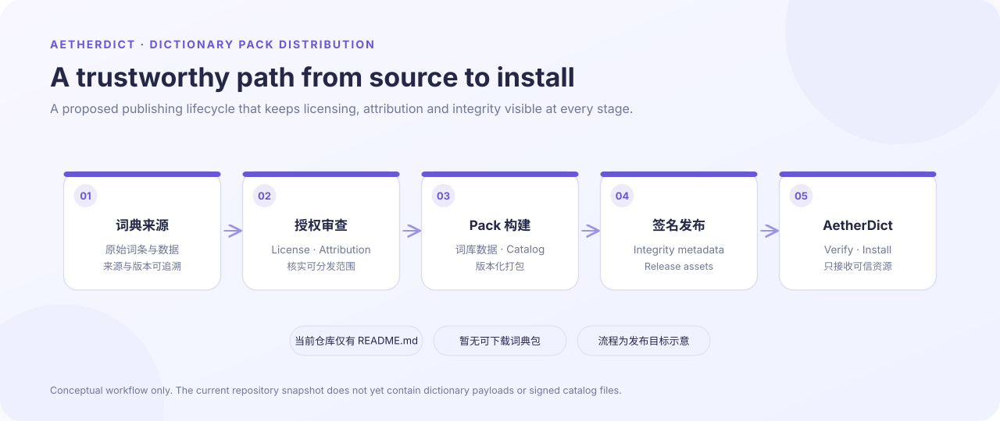
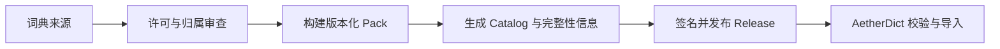

# AetherDict Dictionary Packs

  

用于 AetherDict 桌面翻译工具的独立词典资源分发仓库。仓库职责限定为词典数据、版本目录、来源与许可声明，以及必要的完整性元数据；不放置桌面应用程序源码或用户翻译数据。

> **当前仓库状态：尚未发布可安装词典包。** 当前 GitHub 快照只包含本说明与流程示意图，没有词典数据包、签名 catalog 或 Release 资产。上方图片描述的是目标发布流程，不代表这些产物已经存在。

## 预期发布内容

- 经过来源核查、可合法再分发的词典数据；
- 版本化的 pack manifest / catalog，记录语言、版本、来源、文件摘要与兼容范围；
- 对应的完整性校验与签名材料；
- 每个词典包适用的许可证、版权声明和归属信息。

## 发布流程

## 安全与许可原则

1. 未确认许可和再分发范围的数据不得进入公开包。
2. 每个版本必须能够追溯来源、版本与文件摘要。
3. 下载完成不等于可信；客户端应先校验完整性和签名，再允许导入。
4. 不把用户词典、个人术语库或翻译历史上传到此仓库。

只有在实际词典文件、许可文件、目录和校验材料齐备并通过复核后，才会在此发布可安装版本。
